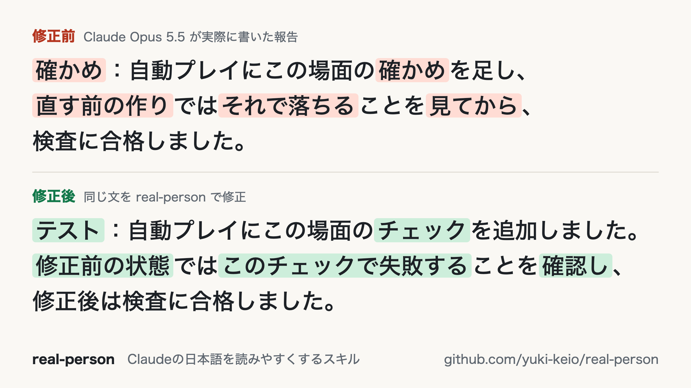

# real-person

## 概要

Claudeの書く日本語を人間らしくするためのスキルです。

書き換え例▼



## 特長

・このスキルのSKILL.mdは敢えて人間が書いています。それによって、スキルの指示自体のAIっぽい表現にモデルが引っ張られてしまう問題を防いでいます

・シンプルに作っているためトークンの追加消費が少ないです。

## 設計思想

AIは自分自身の癖を自覚しづらいという前提で作っています。

一般的に、文章の内容を決めたりタスクの実行をしたりすること自体においては、AIの出力を制約しないことが推奨される場合もあります。しかし文章の「AIっぽさ」を減らすという観点からは、むしろAIが文章のスタイルを決める余地を減らすことで大幅に出力が改善すると感じたので、このスキルでは文章の内容は制約しない一方で、スタイルについてはNG例を具体的に指定することで、AIっぽさが入り込む余地を意図的に減らしています。

## Claude Codeで使用

以下のいずれかの方法でインストールできます

<方法1>  
以下のコマンドをターミナルで実行

```bash
npx skills add yuki-keio/real-person -g -a claude-code -y
```

<方法2>  
`skills/real-person` フォルダを`~/.claude/skills/` にコピペ

## claude.aiで使用

[skills/real-person/SKILL.md](skills/real-person/SKILL.md) をダウンロードし、claude.aiの「カスタマイズ」→「Skills」→「追加」→「Skillsをアップロード」から追加します。

## スキルの活用例

#### (1) インストールするだけで自動適用

人間が読む文章の作成を明確に依頼した場合は、自動でスキルが発動してアシストします。

#### (2) CLAUDE.mdに記載して確実に適用

このスキルを使用したい場面を明示的に指定することで、より多くの場面で確実にスキルを活用できます。

#### (3) ハーネス内にあるAIっぽい表現のチェック

CLAUDE.mdやMEMORY.mdにAI独特の言い回しが溜まっていると、それに引っ張られてAIの出力が偏ってしまうリスクがあります。そこでreal-personを参考にしてCLAUDE.mdやMEMORY.mdなどをチェックするよう頼むことで、ハーネスの内部文書を改善できます

## データの扱い

このスキルの中身は文章の書き方の指示のみです。プログラムの実行や外部へのデータ送信は行わない設計となります。

## English

real-person is a skill that helps Claude write natural Japanese. It lists patterns that make Japanese text read as AI-written, such as too many commas, unnatural metaphors, overused hiragana, unusual word choices, and references the reader cannot follow. Claude uses it when you ask it to make Japanese text sound natural, and when it writes or edits Japanese documents, emails, articles, or reports for people to read. When it edits existing text, it keeps the original meaning and does not add guesses or filler.

The skill is designed on the assumption that AI has trouble noticing its own habits. For deciding what to write or carrying out a task, it is sometimes recommended not to constrain AI output. For reducing the AI-like feel of writing, though, I found that output improves a lot when the AI has less room to decide the style. So this skill leaves the content of the text unconstrained, but gives concrete examples of styles to avoid, to deliberately leave less room for AI-like habits.

This skill only contains writing instructions. It does not run programs or send data anywhere.
